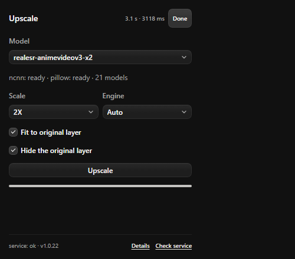
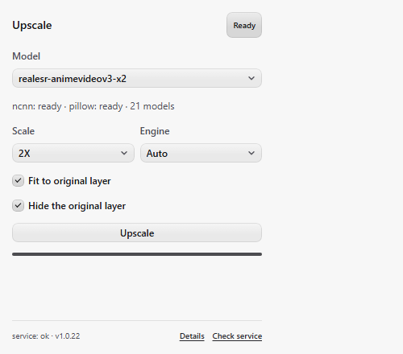
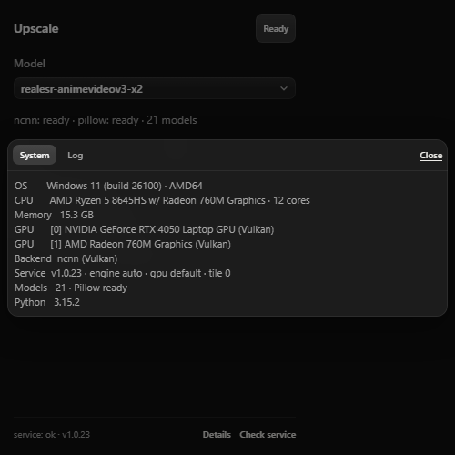
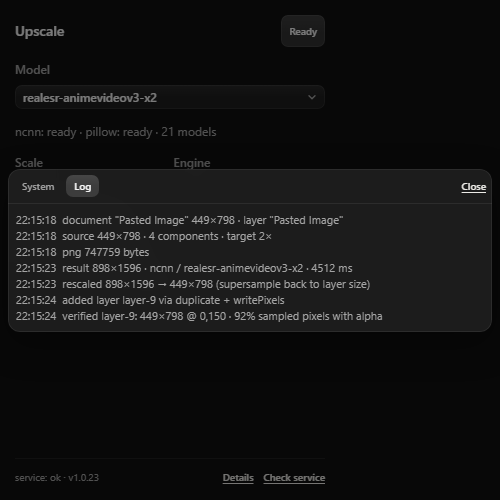
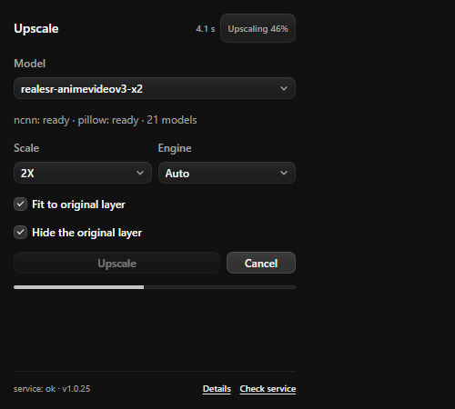
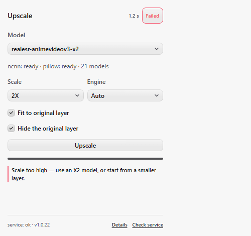
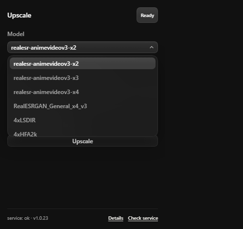

# Photon Upscale

A free, open-source upscaling panel for **[Photon Studio](https://tenzen.studio/photon/)**.
Select a layer, pick an upscale model, and get a higher-resolution version of it back
as a new layer in the same document, at the same position.

Runs entirely on your own machine: no accounts, no cloud, no telemetry, no paid API.

| Dark skin | Light skin |
| --- | --- |
|  |  |

The **Details** button next to *Check service* opens an overlay with two tabs: **System**
(OS, CPU, RAM, Vulkan GPU list, active backend) and **Log** (the step-by-step history, which
is never rendered in the panel body itself).

| System tab | Log tab |
| --- | --- |
|  |  |

```
+-------------- Photon Studio (sandboxed plugin) --------------+
|  selected layer                                              |
|      | documents.pixels        (RGBA pixels + bounds)        |
|      v                                                       |
|  images.encode  -------->  PNG bytes                         |
+-------------------------------+------------------------------+
                                | POST /upscale (localhost only)
                                v
+-------------- local service (Python) ------------------------+
|  upscayl-bin + ncnn model  (or Pillow fallback)              |
|      -> writes out/<timestamp>-<model>-<id>.png              |
+-------------------------------+------------------------------+
                                | raw PNG + metadata header
                                v
+-------------- Photon Studio ---------------------------------+
|  images.decode -> layer.new + documents.writePixels          |
|      -> new raster layer at the original position            |
+--------------------------------------------------------------+
```

---

## Why a local service?

Photon plugins run sandboxed inside a web view: they have no Node.js, no process
spawning and no direct disk access. Upscaling needs a native binary (or a model
runtime), so the plugin talks to a small HTTP service on `127.0.0.1` that does the
heavy lifting. The service only ever listens on the loopback interface.

---

## Requirements

| Requirement | Notes |
| --- | --- |
| Photon Studio | Plugin support verified on **0.1.66** (Windows). `Preferences > Plug-ins > Allow extensions` must be on. |
| Python 3.10+ | 3.15 tested. Only the standard library is required for the ncnn engine. |
| Upscayl (recommended) | Provides the `upscayl-bin` binary **and** 20+ ready models. Auto-detected on Windows, macOS and Linux. |
| Pillow (optional) | Only for the `pillow` engine, or for exact resizing when the requested scale differs from the model's native scale. |

No Upscayl? The plugin still works with the `pillow` engine (fast Lanczos resize, no
AI detail synthesis).

### ncnn vs Pillow

| | **ncnn** (AI) | **Pillow** (classic) |
| --- | --- | --- |
| What it does | Runs a real super-resolution network (Real-ESRGAN / ESRGAN derivatives) | Lanczos resampling |
| New detail | Synthesises edges, texture and fine structure | Interpolates only — magnified edges stay soft |
| Hardware | Vulkan GPU (NVIDIA, AMD, Intel) | CPU only, any machine |
| Speed | ~1–5 s per layer (GPU) | ~20–60 ms |
| Needs | `upscayl-bin` + `.param`/`.bin` models | Just Pillow (`python -m pip install pillow`) |
| Scale | Fixed by the model (2×/3×/4×); other values are resized afterwards | Any `1×`–`8×` |
| Typical artefacts | Over-sharpening or invented texture on some models | Blur / halo on strong edges |
| Good for | Photos, anime, textures, scanned art | Quick enlargement, batch previews, CPU-only machines |

Both end up as an RGBA8 layer in the document. With **Scale the result back to the original
layer size** enabled, ncnn gives the supersample win (AI detail, then a clean downscale);
with Pillow that round-trip is just a resample back to the original size, so uncheck the option
if you only want a bigger result.

### Platform support

| Layer | Windows | macOS | Linux |
| --- | --- | --- | --- |
| Photon plugin (`plugin/`) | yes (verified) | yes (plain HTML/CSS/JS, no native code) | yes |
| Upscale service (`service/`) | yes (verified) | ported: `upscayl-bin` found in `Upscayl.app/Contents/Resources/bin` | ported: `/usr/lib/upscayl`, `/opt`, Flatpak, AppImage, `PATH` |
| Launchers / autostart (`tools/`) | `.ps1`, `.cmd`, VBS + `HKCU\...\Run` | `start-service.sh`, `install-autostart.sh` (launchd LaunchAgent) | same `.sh` scripts (systemd `--user` unit) |

The service itself is plain Python (stdlib + optional Pillow) and has no OS-specific code
except spawning the Upscayl binary without a console window on Windows. The macOS/Linux
paths are implemented but **not yet exercised by the maintainers** — report anything that
does not line up.

macOS specifics to expect:

- Upscayl lives at `/Applications/Upscayl.app/Contents/Resources/` (`bin/upscayl-bin`,
  `models/`). Copies of the models are fine too — drop `.param`+`.bin` pairs into
  `service/models/`.
- Apple Silicon runs the arm64 build natively; `upscayl-bin` renders through MoltenVK, so no
  CUDA/ROCm install is needed. Integration with an Intel Mac works the same way.
- If macOS quarantines a copied binary or model, clear it once:
  `xattr -d com.apple.quarantine service/models/* 2>/dev/null` and the same for the binary.
- Autostart uses a LaunchAgent (`~/Library/LaunchAgents`), so no `sudo` is required.

---

## Quick start

```powershell
# 1. Start the local service (leave the window open)
#    Windows: you can also just double-click tools\start-service.cmd
.\tools\start-service.ps1

# 2. Install the plugin in Photon Studio
#    Preferences > Plug-ins > Install plugin  ->  select this folder:
#    D:\tenzen studio\photon-upscale-plugin\plugin

# 3. In Photon: select a raster layer -> Plugins > Upscale (Ctrl+Shift+U) -> Upscale Layer
```

On macOS / Linux the same three steps use `./tools/start-service.sh`.

### Run it without a terminal window (recommended)

```powershell
.\tools\install-autostart.ps1          # hidden now, and again at every sign-in
.\tools\install-autostart.ps1 -Remove  # undo: stop the service and drop the autostart entry
.\tools\stop-service.ps1               # stop the hidden instance
```

- The service runs under `pythonw.exe` through a tiny VBS launcher, so **no console window
  appears** — not even a flash at sign-in.
- Autostart is a per-user `HKCU\Software\Microsoft\Windows\CurrentVersion\Run` entry, so no
  administrator rights are needed and nothing is installed system-wide.
- Output goes to `service/logs/service.log` (rotated to `service.1.log` past 2 MB).
- `upscayl-bin.exe` is a console program; it is spawned with `CREATE_NO_WINDOW`, so hidden
  mode never flashes a console window during an upscale.
- Starting it twice is safe: a second instance detects that the port already answers and
  exits instead of hijacking the live one (Windows `SO_REUSEADDR` allows that otherwise).
- `tools\start-service.cmd` still works when you want a console with live logs.

macOS / Linux use the shell equivalents:

```bash
chmod +x tools/*.sh
./tools/start-service.sh              # foreground, live logs
./tools/install-autostart.sh          # launchd LaunchAgent / systemd --user unit, starts now
./tools/install-autostart.sh --remove # stop and drop the autostart entry
./tools/stop-service.sh               # stop the background instance
```

Both start the service with the interpreter from `PATH` (override with `PYTHON=/path/to/python3`),
append to `service/logs/service.log`, and need no root: macOS writes
`~/Library/LaunchAgents/<label>.plist`, Linux writes
`~/.config/systemd/user/photon-upscale.service`.

---

## Installing the plugin

Photon installs plugins from a **folder**, a `.photon-plugin`, `.ccx`, `.zxp` or
`.zip` archive:

1. Open **Preferences > Plug-ins** in Photon Studio.
2. Choose **Install plugin** and pick the `plugin` directory of this repository.
3. Enable the plugin if it is listed as disabled.

Photon copies the folder into its own package store
(`%APPDATA%\Photon Studio\plugins\packages\<key>\<hash>`) and records it in
`registry.json`. Because it was installed from a folder, Photon also remembers the
source path as `developmentSource`, which enables **Reload** after you edit the panel.

> The plugin is unsigned, so Photon reports the compatibility as *unverified*. That is
> expected for locally developed plugins.

---

## Using the panel

1. Open a document and select **one raster layer** in the Layers panel.
2. Pick a **model** and a **scale** (`1x`-`4x`).
   The scale dropdown is synced to the model's native scale (a `4x...` model selects `4x`).
3. Choose an **engine**: `Auto` prefers ncnn, falls back to Pillow.
4. Leave **Scale the result back to the original layer size** checked to run the
   supersample workflow described below; uncheck it to keep the enlarged pixels.
5. Click **Upscale Layer**. While the model runs, a **Cancel** button appears next to it:
   pressing it stops the service at once (the `upscayl-bin` process is terminated), no output
   file is written, and the badge reads `Cancelled` — the original layer stays untouched.

What happens:

- The selected layer's pixels and document-space bounds are read.
- The pixels are encoded as PNG and posted to the local service.
- The service runs the model, writes `service/out/<timestamp>-<model>-<id>.png`, and
  returns the raw PNG plus a metadata header.
- The plugin decodes those pixels in memory and writes them into a **new raster layer**,
  positioned where the source layer was.

While the model runs, the panel shows the live stage and a **Cancel** button:


- The new layer is read back and checked for opaque pixels. Only a verified result hides
  the original layer; a rejected result is deleted and the document stays untouched.
- By default the original layer is hidden (not deleted), so the change stays reversible.

The panel body stays terse: a **status badge** plus the elapsed time when a run finishes
(`Done · 3.1 s · 3118 ms`). During a run the badge follows the real stage
(`Reading`, `Encoding`, `Upscaling 53%`, `Rescaling`, `Saving`, …) and the timer ticks live.

A failure adds **one actionable line** under the badge — for example *“Scale too high — use 2×,
a smaller model, or start from a smaller layer.”*, *“GPU out of memory — lower the scale, or set
`tile`: 512”*, *“Service is offline — start it with tools\start-service.cmd”*. The full message
stays in the badge tooltip and in **Details → Log**.



The bar itself is driven by the service's `GET /progress` stages, so it follows the work and
only moves forward — it never loops as an indeterminate animation.

### Supersample: same footprint, better pixels

With **Scale the result back to the original layer size** enabled (the default), the flow is:

```
export layer (449×798)  ->  upscale 2x (898×1596)  ->  Lanczos back to 449×798  ->  new layer
```

The new layer covers exactly the same rectangle as the layer it replaces, so it drops into
place without moving anything, while the pixels went through the model and a high-quality
downscale. That is the classic upscale-then-downscale pass: the model resolves edges and
removes compression noise, the Lanczos step keeps the detail that fits the original size.

Uncheck the option to keep the enlarged result instead (a 2x/4x layer that is bigger than
the source) — useful when you actually want more pixels on the canvas.

The rescale step needs Pillow (`python -m pip install pillow`). Without it the service
returns the enlarged image and the panel shows a note.

### How insertion works

`documents.applyImage` needs a capture token for in-document edits, and on some stock Photon
builds it creates the layer without filling its pixels (the canvas stays empty and the
document memory does not grow). The panel therefore inserts through the pixel-writing path,
trying three strategies in order:

1. **duplicate + writePixels** (preferred) — `layer.duplicate` the source layer, so the new
   layer already has a real surface, matching channel count and the same offset, then
   `documents.writePixels(documentId, layerId, transfer)` replaces its pixels with the
   upscaled RGBA8 data through the imaging worker. The transfer rect is **document space**
   (Photon converts it with `rect - layer.offset`), so the pixels are written at the source
   layer's exact X/Y instead of the canvas origin;
2. **layer.new + writePixels** — create an empty raster layer with `layer.new`, write the
   pixels at the origin, then `layer.translate` it to the source position;
3. **applyImage** — the SDK image import path, with the offset baked in as transparent
   top-left padding.

Every path ends with verification: the layer is read back (`documents.pixels`) and must hold
opaque pixels, at least the expected dimensions **and the expected X/Y**. Only a verified
result hides the original layer; a rejected result is deleted so the document stays untouched.

An active selection is refused up front: Photon masks plugin pixel writes with the selection,
which would leave a partially written layer.

> `image.place` is an *automation* operation (used by the Photon CLI/MCP), not part of the
> plugin runtime surface in Photon 0.1.66.

---

## Models

The service looks for models in two places, in this order:

1. **`service/models/`** - this repository's own folder (drop your own models here).
2. **Upscayl's bundled model folder**, auto-detected:
   - `%ProgramFiles%\Upscayl\resources\models`
   - `%LOCALAPPDATA%\Programs\Upscayl\resources\models`

An ncnn model is a **pair**: `<name>.param` + `<name>.bin`. Sub-folders are scanned
too, so you can organise collections. The file stem becomes the model id shown in the
panel. See [service/models/README.md](service/models/README.md) for details.

**Scale handling.** The native scale is read from the model name (`4x...`, `...-x2`,
`...-4x`). If you request a different scale, the model still runs at its native scale
and the result is resized to the requested size - that resize needs Pillow. Without
Pillow you get the native scale and the panel prints a note explaining it.

---

## Configuration

`service/config.json` (all keys optional, CLI flags override them):

| Key | Default | Meaning |
| --- | --- | --- |
| `host` | `127.0.0.1` | Bind address. Keep it on loopback. |
| `port` | `8765` | Port the plugin expects. |
| `models` | `models` | Model folder, relative to `service/` or absolute. |
| `out` | `out` | Output folder for generated PNG files. |
| `binary` | `""` | Explicit path to `upscayl-bin`. Empty = auto-detect. |
| `engine` | `auto` | `auto`, `ncnn` or `pillow`. |
| `gpu` | `""` | Vulkan device index passed to `upscayl-bin -g`. Empty = let it choose. |
| `tile` | `0` | Maximum tile size passed to `upscayl-bin -t`. `0` = automatic. |
| `extraArgs` | `[]` | Extra arguments forwarded to `upscayl-bin`. |

### Hardware: NVIDIA, AMD, Intel or CPU

`upscayl-bin` renders through **Vulkan**, not CUDA, so the same build and the same models
run on NVIDIA, AMD and Intel GPUs without any extra configuration — there is nothing
vendor-specific to install. Leave `engine` at `auto`:

| Machine | What happens |
| --- | --- |
| NVIDIA GPU | ncnn via Vulkan. Optionally pick a device with `gpu` when there are several. |
| AMD GPU | ncnn via Vulkan, same models. (Recent AMD drivers ship Vulkan.) |
| Intel iGPU | ncnn via Vulkan; slow but works. Lower `tile` if memory errors appear. |
| Multiple GPUs | Set `gpu` to the Vulkan index (`0`, `1`, …) to choose one. |
| CPU only / no Vulkan driver | ncnn fails, and `auto` **falls back to Pillow** automatically and reports the reason in the response `note`. |

Because of that fallback, the plugin never hard-fails on machines without a Vulkan device —
it just produces a Lanczos result instead of an AI one. If you prefer to know up front, set
`engine` to `pillow` (CPU only) or `ncnn` (fail loudly when the GPU path is unavailable).

The panel shows the routing under the model dropdown: `ncnn: ready · pillow: ready · 21 models`,
plus `gpu 1` / `tile 512` when configured. `GET /health` reports `engine`, `gpu`, `tile` and
`cpuFallback` as well.

Command line:

```text
python server.py [--host H] [--port N] [--models DIR] [--out DIR]
                 [--bin PATH] [--engine auto|ncnn|pillow] [--extra-arg ARG ...]
```

Environment variable `PHOTON_UPSCALE_BIN` also points at the binary.

Binary auto-detection order: `--bin`, `PHOTON_UPSCALE_BIN`, `service/bin/`, then Upscayl's
`resources/bin` for this OS, then `PATH`:

| OS | Upscayl `resources` looked up |
| --- | --- |
| Windows | `%ProgramFiles%\Upscayl\resources`, `%ProgramFiles(x86)%\…`, `%LOCALAPPDATA%\Programs\Upscayl\resources` |
| macOS | `/Applications/Upscayl.app/Contents/Resources`, `~/Applications/Upscayl.app/Contents/Resources` |
| Linux | `/usr/lib/upscayl/resources`, `/usr/share/upscayl/resources`, `/opt/Upscayl/resources`, `/opt/upscayl/resources`, `~/.local/share/upscayl/resources`, Flatpak app dir |

---

## Service HTTP API

Everything returns JSON by default. The service binds to `127.0.0.1` only.

### `GET /health`

```json
{
  "ok": true,
  "version": "1.0.2",
  "engine": "auto",
  "binaryPath": "C:\\Program Files\\Upscayl\\resources\\bin\\upscayl-bin.exe",
  "pillow": true,
  "models": [{ "name": "4xLSDIR", "dir": "...", "scale": 4 }],
  "modelDirs": ["..."],
  "outDir": "...",
  "python": "3.15.2"
}
```

### `GET /models`

```json
{ "ok": true, "models": [{ "name": "4xLSDIR", "dir": "...", "scale": 4 }] }
```

### `GET /progress`

Live stage of the current (or last) upscale. The panel polls this to drive a determinate
progress bar instead of an indeterminate loop. Values are monotonic within a run.

```json
{ "ok": true, "value": 0.53, "label": "upscaling with model", "estimateMs": 4100, "elapsedMs": 2450 }
```

Stages: `receiving layer` → `preparing layer` → `upscaling with model` (0.15 to 0.90,
advanced by an asymptotic curve from the measured duration of the previous run for the same
model/scale/size) → `rescaling to layer size` → `saving result` → `done`.

### `GET /system`

System report used by the panel's **Details → System** tab. `?probe=1` runs one tiny
upscale first so ncnn enumerates its Vulkan devices (cached afterwards).

```json
{
  "ok": true,
  "os": { "name": "Windows", "pretty": "Windows 11 (build 26100)", "arch": "AMD64" },
  "cpu": { "name": "AMD Ryzen 5 8645HS w/ Radeon 760M Graphics", "cores": 12 },
  "memoryGb": 15.3,
  "python": "3.15.2",
  "executable": "C:\\Python315\\pythonw.exe",
  "devices": [
    { "index": 0, "name": "NVIDIA GeForce RTX 4050 Laptop GPU" },
    { "index": 1, "name": "AMD Radeon 760M Graphics" }
  ],
  "backend": "ncnn (Vulkan)",
  "cpuFallback": true,
  "service": {
    "version": "1.0.10", "engine": "auto", "gpu": "default", "tile": 0,
    "binary": "C:\\Program Files\\Upscayl\\resources\\bin\\upscayl-bin.exe",
    "pillow": true, "models": 21
  }
}
```

The GPU list comes from ncnn's own startup output (`[0 NVIDIA …]`), so it reports the
devices the upscaler will actually see, on any vendor, and the indices match `-g`.

### `POST /upscale`

`multipart/form-data` with these fields:

| Field | Type | Meaning |
| --- | --- | --- |
| `image` | file (PNG) | Layer pixels, sRGB, RGBA or RGB. Required. |
| `scale` | text | `1`-`8`, default `2`. |
| `model` | text | Model id; empty = pick one matching the scale. |
| `engine` | text | `auto`, `ncnn`, `pillow`. |
| `response` | text | `json` (default) or `bytes`. |
| `targetWidth` / `targetHeight` | text | Optional: Lanczos-rescale the result to this size (supersample). Needs Pillow. |

When a target size is given, the metadata gains `rescaledFrom: [w, h]` and
`rescaledTo: [w, h]`; the file on disk is the rescaled one.

**`response=json`** returns metadata:

```json
{
  "ok": true,
  "path": "D:\\...\\service\\out\\20261103-210412-layer-1a2b3c4d.png",
  "width": 256,
  "height": 192,
  "engine": "ncnn",
  "model": "4xLSDIR",
  "nativeScale": 4,
  "scale": 2,
  "elapsedMs": 1843.2,
  "bytes": 48211,
  "inputBytes": 3120
}
```

**`response=bytes`** (what the panel uses) returns the raw PNG as the body with
`Content-Type: image/png` and the same metadata in a header, base64-encoded JSON:

```
x-upscale-meta: eyJvayI6dHJ1ZSwid2lkdGgiOjEyOCwiaGVpZ2h0Ijo5NiwuLi59
```

The plugin needs the pixels in memory because `documents.applyImage` takes an image, not
a path. The file is still written to `service/out/` for history and debugging.

Errors use `400` (bad request), `409` (cancelled) or `500` (upscale failure) with
`{ "ok": false, "error": "..." }`.

Manual test with PowerShell:

```powershell
# raw PNG body + query parameters is also accepted
curl.exe -X POST "http://127.0.0.1:8765/upscale?scale=2&model=4xLSDIR" `
  -H "Content-Type: image/png" --data-binary "@layer.png"
```

### `POST /cancel`

Stops the upscale that is currently running: the service terminates the `upscayl-bin` child
process (or aborts before the Pillow resize), never saves a file, and answers the pending
`/upscale` request with `409 {"ok": false, "error": "cancelled"}`.

```json
{ "ok": true, "cancelled": true }
```

`cancelled` is `false` when nothing was running. The panel's **Cancel** button calls this and
then shows the badge `Cancelled` — the original layer is untouched and no new layer is added.

---

## How the plugin talks to Photon

| Photon capability | Usage |
| --- | --- |
| `documents.active()` | Title, dimensions, colour mode, depth, selected layer ids |
| `documents.pixels({ layerId })` | RGBA pixels of the selected layer + its document bounds |
| `documents.operations("")` | Which document operations this runtime may run |
| `images.encode(image, { maxEdge })` | Pixels -> PNG bytes |
| `network.allowEndpoint(origin)` | One-time approval for `http://127.0.0.1:8765` |
| `network.request({ multipart, response })` | POST the PNG, receive raw PNG bytes |
| `network.request({ json })` → `POST /cancel` | Stop a running upscale (Cancel button) |
| `images.decode(bytes)` | PNG bytes -> RGBA pixels in memory |
| `documents.execute("layer.new", { name })` | Create the empty raster layer that receives the result |
| `documents.writePixels(documentId, layerId, transfer)` | Write the upscaled RGBA8 pixels into that layer |
| `documents.execute("layer.translate", { layerIds, dx, dy })` | Move the layer to the source position, when available |
| `documents.execute("layer.visibility", { layerIds, visible })` | Hide the original layer (optional) |

The manifest declares `document: "readWrite"` and `customEndpoints: true`. No file or
network permission is needed beyond the approved loopback origin.

### Hard limits enforced by Photon

| Limit | Value | Where it is handled |
| --- | --- | --- |
| Plugin pixel transfer (read/write) | 16 MP | checked before reading pixels |
| `images.encode` / `images.decode` edge | 8192 px | checked against `scale * longest side` |
| Image accepted by `applyImage` | 16 MP, 8192 px per side | checked on the result |
| Network upload/response | 64 MB | checked by Photon |
| Panels / commands per plugin | 20 / 100 | manifest design |

In practice: a 4 MP layer can go to 2x (16 MP) but not 4x, and a layer whose upscaled
result exceeds 16 MP is rejected with a message telling you to pick a smaller scale.

---

## Limitations

- **8-bit RGB documents only.** 16/32-bit or CMYK documents are rejected with a clear message.
- **One raster layer at a time.** Text, shape and group layers must be rasterized first.
- **Result size** must fit 16 MP and 8192 px per side (Photon's transfer limits).
- **ncnn needs a Vulkan-capable GPU.** Without one, use `--engine pillow`.
- **The service must be running.** The plugin is a thin client; it cannot start processes.
- **Install/reload is a UI action.** Photon has no automation adapter for plugin management.
- Large layers can take a while; the service allows up to 15 minutes per request.

---

## Troubleshooting

| Symptom | Fix |
| --- | --- |
| `service: unreachable` in the panel | Start `tools\start-service.cmd` (or `.ps1`); make sure the port matches `8765`. |
| "Plugin has no permission for this network origin" | Click **Check service** once and approve the prompt in Photon. |
| "No engine is ready" | Install Upscayl, set `--bin`, or `python -m pip install pillow`. |
| "upscayl-bin failed: ...vkCreateInstance..." | No Vulkan GPU/driver available - use `--engine pillow`. |
| "This layer has no raster pixels" | Rasterize the text/shape/group layer first. |
| "above the 16 MP layer limit" | Pick a smaller scale, or upscale in two passes. |
| Result softer than expected | The requested scale differs from the model's native scale and Pillow is missing - install Pillow. |
| Panel shows nothing after an edit | Photon caches the installed copy - use **Reload** on the plugin. |

Service logs are printed in the console window; Photon's own log is at
`%APPDATA%\Photon Studio\logs\photon.log`.

---

## Development

```text
plugin/     Photon plugin (manifest, panel UI, SDK calls) - no build step, plain ES2020
service/    Python HTTP service + upscale engines
tools/      start-service.ps1 / .cmd, smoke_test.py
docs/       panel screenshots
```

- The panel is plain HTML/CSS/JS; there is no bundler and no npm dependency.
- After editing `plugin/`, use **Reload** in Photon's plugin list (or reinstall the folder).
- Verify the service without Photon:

```powershell
python tools\smoke_test.py                    # auto engine
python tools\smoke_test.py --engine ncnn --scale 4
python tools\smoke_test.py --engine pillow --scale 2
```

The smoke test starts the server on a temporary port, sends a generated PNG through the
same multipart requests the plugin uses (both `json` and `bytes` response modes), and
checks dimensions, metadata header, engine and the written output file.

### Theme and styling

Every colour in the panel resolves from the **host design system at runtime**, not from a copied
palette. Photon injects a fixed token subset into a custom panel (verified in
`dist/assets/PluginPanelRouter-*.js` of 0.1.66):

```
--ph-black-0 … --ph-black-8, --ph-text, --ph-muted, --ph-soft,
--ph-accent, --ph-accent-bright, --ph-accent-deep,
--ph-control, --ph-control-hover, --ph-control-active,
--ph-hairline, --ph-stroke, --ph-stroke-strong,
--ph-glass-plate, --ph-glass-plate-strong, --ph-danger
```

`plugin/panel.css` maps its own variables onto those tokens, so the panel follows all four
Photon skins (`dark`, `softDark`, `light`, `softLight`) with the host's own values:

| Panel role | Host token |
| --- | --- |
| ground | `--ph-black-4` (chrome) |
| text / secondary | `--ph-text` / `--ph-muted` / `--ph-soft` |
| control fill, hover, pressed | `--ph-control` / `--ph-control-hover` / `--ph-control-active` |
| lines and edges | `--ph-stroke` / `--ph-stroke-strong` / `--ph-hairline` |
| popup surface | `--ph-glass-plate-strong` (+ hairline) |
| links and progress | `--ph-accent` |
| errors | `--ph-danger` |

Photon does **not** expose radius, spacing, type or depth tokens to plugins, so those numbers
come from Photon's published scale instead of being invented: 7px control radius
(`--ph-radius-7`, matches `.tz-button.tz-editor`), 12px card radius (`--ph-radius-12`, matches
`.tz-select-menu`), 24px editor control height, 12px body text (`--ph-text-base`), the Inter /
system font stack, and the `--ph-depth-raised` shadow shape.

The dropdowns are custom widgets (`plugin/select.js`) built with the same tokens: `--ph-glass-plate-strong`
popup, `--ph-control-active` for the selected row, `--ph-soft` scrollbar thumb, 12px radius.



---

## Changelog

### 1.0.25

- **Cancel button** in the panel: while a run is in progress the Upscale button is disabled and a
  **Cancel** button appears next to it, styled as an active (pressed) default control rather than
  a destructive one. It calls the new `POST /cancel` endpoint, the service terminates the
  `upscayl-bin` child process (Pillow path aborts before the resize), nothing is written to
  `service/out`, and the badge reads **Cancelled** with the original layer untouched.
- Service: the ncnn run is now a polled `Popen` (stdout/stderr go to files so a full pipe cannot
  deadlock), which is what makes the process interruptible; the 900 s timeout keeps working.
- `POST /cancel` answers `{"ok": true, "cancelled": <bool>}` and the cancelled run replies to
  `/upscale` with HTTP 409 `{"error": "cancelled"}`.

### 1.0.24

- Controls are painted with Photon's own two-layer recipe again: a `--ph-raise` sheen over the
  `--ph-control` wash, plus `--ph-control-hover`/`--ph-control-active` for hover and press. The
  layer values are not in the plugin token set, so they are reproduced per skin from the host
  stylesheet (light vs dark) — the gradient you see in Photon's own buttons and dropdowns.
- Popovers (dropdown menu, details overlay) now stack `--ph-glass` over `--ph-glass-plate-strong`
  like `.tz-select-menu`, instead of using the plate colour alone.
- The dropdown chevron rotates 180° while the menu is open (`transform`, 190ms,
  Photon's `--ph-ease-standard`) and the trigger keeps its open state, matching the native
  dropdown behaviour.

### 1.0.23

- Panel colours are now sourced from the **host design system at runtime** instead of a copied
  palette: ground `--ph-black-4`, text/muted/soft, `--ph-control*` for every control state,
  `--ph-stroke*`/`--ph-hairline` for edges, `--ph-glass-plate-strong` for popups,
  `--ph-accent` for links/progress and `--ph-danger` for errors. The panel now matches all four
  Photon skins with the application's own values (`softDark`/`softLight` included).
- Controls follow Photon's own recipe (control fill + hairline, hover `--ph-control-hover`), so
  the previous Tenzen gradients were removed.
- Dropped the bundled Plus Jakarta Sans; typography uses the Inter/system stack Photon itself
  uses. Shape stays on Photon's scale: 7px controls, 12px cards, 24px editor height, 12px text.

### 1.0.22

- Fix the model dropdown being sometimes clickable and sometimes not: it is no longer disabled
  when Engine is Pillow (the native select and the custom trigger could disagree about the
  disabled state). The model stays selectable and is simply ignored while Pillow is active —
  the note under the button says so.
- Panel background now adapts to **all four** Photon skins: ground/text/border come from
  `--ph-black-3` / `--ph-text` / `--ph-stroke-strong`, with `softLight` and `softDark` getting
  their own control gradients so the buttons do not disappear into the surrounding surface.

### 1.0.21

- Custom dropdowns for Model / Scale / Engine built from the design system's list designs:
  `List items` (87:85) and `List items scroll style` (88:205) — 12px popup radius, #f7f7f7
  surface with #fafafa border and drop shadow, 24px rows with radius 4 (radius 7 + #dedede for
  the selected row), and the 3px scrollbar with a 26px-radius thumb for the long model list.
- `plugin/select.js` keeps the native `<select>` hidden in the DOM so the panel logic is
  unchanged; selection is mirrored both ways.

### 1.0.20

- Panel rebuilt from the Figma design system: `sample white mode` (87:50) for light and
  `sample dark mode` (87:142) for dark — gradient controls, 24px control height, 7px radii,
  15px panel padding, 13px section gap, status pill in the header, and the design's own labels
  (`Fit to original layer`, `Hide the original layer`, `Upscale`).
- Bundled the design's typeface, **Plus Jakarta Sans** (variable latin subset, SIL OFL 1.1), so
  the panel matches the design without relying on the host having the font installed.
- Dark palette is chosen from Photon's `data-photon-theme`; the details overlay, progress bar
  and reason line were restyled to the same language.

### 1.0.19

- Repo hygiene: added `.gitattributes` so the POSIX scripts stay LF while `*.cmd`/`*.ps1`/
  `*.vbs` are checked out as CRLF, and binaries (`png`, `bin`, `exe`, …) are never converted.
  Without it a Windows contributor with `core.autocrlf=true` could break `tools/*.sh`.
- Re-audited `.gitignore`: a temporary git index shows exactly **30 files** would be
  committed (code, docs screenshots, licenses, `.gitkeep` placeholders) and **119 files /
  ~1 GB** stay local (models, `service/out`, `service/logs`, `__pycache__`, the generated
  `service-hidden.vbs`). Added `.vscode/` and `.idea/`.

### 1.0.18

- Fix `layer.rename` parameters: Photon expects a single `{ layerId, name }`, not
  `{ layerIds, [..] }` like the other layer operations. That call failed silently in Photon's
  diagnostics three times per run (*"Invalid parameters for layer.rename"*) while leaving the
  new layer with the internal name. Every other operation used by the plugin was re-checked
  against the host schemas (`layer.delete`, `layer.translate`, `layer.visibility`, `layer.new`,
  `layer.duplicate`).

### 1.0.17

- Selecting Pillow (or Auto resolving to it) now turns off *scale back to the original layer
  size* automatically and explains why, because that round-trip cancels the enlargement and
  looks like nothing happened. The model dropdown is disabled while Pillow is in use (Pillow
  takes no model), and a finished Pillow run that still has scale-back enabled shows the same
  hint under the badge.

### 1.0.16

- Add `THIRD_PARTY_NOTICES.md` and a licensing section: this repo ships no model weights and
  no Upscayl binary (verified: Upscayl is AGPL-3.0 and its `models/` folder contains no license
  files at all), so model terms stay with each model author and with whoever runs the upscale.

### 1.0.15

- README documents the difference between the two engines (ncnn vs Pillow) and what to expect
  on macOS (Upscayl.app paths, MoltenVK on Apple Silicon, quarantine, LaunchAgent).
- The log warns when Pillow is combined with *scale back to the original size*, because that
  round-trip is a plain resample of the original.

### 1.0.14

- Failures now show a compact, actionable line under the badge instead of only a tooltip:
  scale/model too high, GPU out of memory, service offline, active selection, empty layer,
  unusable result. It is clamped to two lines with the full text in the tooltip and the log.
- The service detects Vulkan allocation failures from `upscayl-bin` and appends the
  `tile`/scale hint so the panel can say *“GPU out of memory”* instead of a raw exit code.

### 1.0.13

- Panel body trimmed to the essentials: the tagline under the title is gone and the long
  result line is replaced by a **status badge** (`Reading` → `Upscaling 53%` → `Done`) plus the
  elapsed time (`3.1 s · 3118 ms`). Failures show `Failed`; the reason lives in the tooltip and
  in **Details → Log**.
- One version for the whole release: the service reads `plugin/photon.plugin.json` at startup
  instead of hard-coding its own number, so the panel footer (`service: ok · vX`) and the
  Photon plugin list can no longer drift apart.

### 1.0.12

- New **Details** overlay with two tabs: **System** and **Log**. The System tab reports OS and
  build, CPU model and cores, RAM, the Vulkan GPU list with device indices, the active backend
  (`ncnn (Vulkan)` or `pillow (CPU)`), service settings, model count and Python version.
- New `GET /system` endpoint (`?probe=1` asks ncnn to enumerate its Vulkan devices once; the
  list is cached and de-duplicated because ncnn prints it per worker). Service version 1.0.10.
- `service/sysinfo.py` collects OS/CPU/memory per platform without extra dependencies.

### 1.0.11

- Hardware routing made explicit: `gpu` (`upscayl-bin -g`) and `tile` (`-t`) config keys plus
  `--gpu` / `--tile` flags, surfaced in `/health` (`engine`, `gpu`, `tile`, `cpuFallback`) and
  in the panel hint.
- `engine: auto` now **falls back to Pillow when ncnn fails** (no Vulkan device, broken
  driver, unusable binary) and explains it in the response `note`, instead of failing the run.
  `engine: ncnn` still fails loudly. Service version 1.0.9.
- README gains a GPU/CPU matrix: Vulkan covers NVIDIA, AMD and Intel with the same models.

### 1.0.10

- Cross-platform service: Upscayl discovery now covers macOS (`Upscayl.app/Contents/Resources`)
  and Linux (`/usr/lib/upscayl`, `/usr/share/upscayl`, `/opt`, `~/.local/share/upscayl`,
  Flatpak) in addition to the Windows locations, and the binary must be executable.
- New POSIX tooling: `tools/start-service.sh`, `tools/stop-service.sh` and
  `tools/install-autostart.sh` (launchd LaunchAgent on macOS, systemd `--user` unit on Linux).
- README documents the per-OS support matrix. Service version 1.0.8.

### 1.0.9

- Replace the looping (indeterminate) progress animation with a determinate bar driven by
  the service: `GET /progress` reports the live stage and the panel polls it every 250 ms.
- The service advances the model stage along an asymptotic curve derived from the measured
  duration of the previous run for the same model/scale/size, then reports
  `rescaling` → `saving` → `done`. Progress only moves forward within a run and is reset at
  the start of the next one. Service version 1.0.7.

### 1.0.8

- Fix the result landing at the canvas origin instead of the source layer's position:
  `documents.writePixels` takes a **document-space** rect (Photon converts it with
  `rect - layer.offset`), so the transfer now passes the layer's X/Y.
- Verification now also checks X/Y, and the status line reports them
  (`… 449×798 @ X0 Y150 · 92% alpha`).
- Refuse to run when the document has an active selection, because Photon masks plugin
  pixel writes with it (the result would be partially written).

### 1.0.7

- Run the service without a terminal: `tools/install-autostart.ps1` starts it hidden with
  `pythonw.exe` plus a VBS launcher and registers a per-user Run entry, so it returns at
  every sign-in. `tools/stop-service.ps1` stops it; `-Remove` undoes the autostart.
- Hidden mode logs to `service/logs/service.log` with a 2 MB rotation.
- `upscayl-bin.exe` is spawned with `CREATE_NO_WINDOW`. Without it, a GUI parent process
  (`pythonw`) makes Windows open a fresh console window for every upscale.
- The service now refuses a second instance instead of binding the same port twice
  (Windows `SO_REUSEADDR` quirk). Service version 1.0.6.

### 1.0.6

- New **Scale the result back to the original layer size** option (on by default): the
  service upscales, then Lanczos-rescales the result to the exported layer's pixel size, so
  the new layer occupies exactly the same rectangle as the layer it replaces
  (supersample pass). Service side: `targetWidth` / `targetHeight` request fields and
  `rescaledFrom` / `rescaledTo` metadata; service version 1.0.4.

### 1.0.5

- Move the activity log out of the panel body: a **Logs** button now sits next to
  *Check service* in the footer and opens the log in an overlay (close with the button,
  a backdrop click, or Escape). The panel itself stays a clean form plus one status line.
- Keep a rolling 300-line log buffer so the history is available even though it is not
  rendered inline.

### 1.0.4

- Insert by **duplicating the source layer** and replacing its pixels with
  `documents.writePixels` — the duplicate always has a real surface, matching channels and
  the right offset. `layer.new` + `writePixels` and `applyImage` remain as fallbacks.
- Never hide the original layer unless the new layer passed verification (size and alpha
  coverage). A rejected result is deleted, so the document is left exactly as it was.
- Remove half-written layers before falling back, and delete the empty layer when every
  path fails.
- Translate the host's terse imaging error ("Invalid or oversized plugin pixel buffer")
  into actionable advice when a selected layer has no pixel data.

### 1.0.3

- Insert the result through `layer.new` + `documents.writePixels` instead of
  `documents.applyImage`. On stock Photon 0.1.66 `applyImage` returned a layer id but left
  the layer without pixels, so the canvas stayed empty.
- Read the new layer back after insertion and report the measured alpha coverage in the
  status line, so a silent empty layer is visible immediately.
- Add a progress bar with stage feedback and an elapsed timer during the model run.
- Remove the activity log; the panel is now a single status line plus the progress bar.
- Keep `applyImage` as a fallback when `layer.new` is unavailable.

### 1.0.2

- Switch layer insertion to `documents.applyImage` (SDK surface). The previous
  `documents.execute("image.place", ...)` path failed with *"Unknown operation:
  image.place"* because that operation is automation-only in Photon 0.1.66.
- Service gained a `bytes` response mode: raw PNG body plus base64 JSON metadata in the
  `x-upscale-meta` header, so the plugin no longer needs file access or a path.
- Position the new layer with `layer.translate` when the host exposes it, otherwise bake
  the offset into the image as transparent top-left padding.
- Guard the result against Photon's 16 MP / 8192 px limits.
- Fix the activity log auto-scroll.

### 1.0.1

- Fix the `images.encode` call signature (`encode(image, options)`) that made every run
  fail with *"Invalid RGBA image"*.
- Restyle the panel to the Photon custom-panel design language.
- Clearer message when the local service is not running.

### 1.0.0

- First release: selected layer -> PNG -> local upscale service -> new layer.

---

## Privacy

- The service listens on `127.0.0.1` only and is never exposed to the network.
- No image, path or usage data leaves your machine.
- The only network call the plugin makes is to the loopback origin you approve once.
- Generated PNGs stay in `service/out/` until you delete them.

---

## License

MIT — see [LICENSE](LICENSE). Free to use, modify and redistribute, including commercially.

That covers **this project's code only**. Two things it cannot cover:

| Component | Status |
| --- | --- |
| **Upscayl / `upscayl-bin`** | Upscayl is **AGPL-3.0** (verified in the installed 2.15.0 metadata). This project does not bundle it; the service only starts the copy the user installed, as a separate local process. Bundling or modifying it would put AGPL obligations on whoever redistributes it. |
| **Model weights** (`.param` + `.bin`) | Each model author sets the license, and they differ. Several popular community models are non-commercial or require credit, and Upscayl's `models/` folder ships **no license files at all**, so the terms cannot be read from the download. This repo never redistributes weights — `service/models/*` is git-ignored — so choosing a legally usable model is on the person running the upscale. |

Read [THIRD_PARTY_NOTICES.md](THIRD_PARTY_NOTICES.md) before publishing or selling anything
built on this plugin. Not legal advice.
